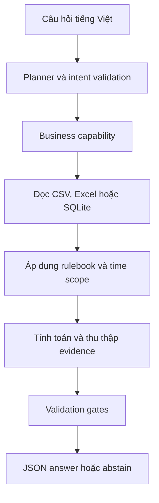

# DataMate Agent

Hệ thống hỏi đáp dữ liệu doanh nghiệp bằng tiếng Việt, được xây dựng cho cuộc thi DataMate.

Agent đọc dữ liệu CSV, Excel và SQLite, xác định ý định của câu hỏi, áp dụng quy tắc nghiệp vụ, thực thi phép tính và trả về JSON theo đúng hợp đồng đầu ra.

> Repository chỉ chứa mã nguồn, cấu hình, kiểm thử và tài liệu kỹ thuật. Dữ liệu `train`, `public_test`, môi trường `.venv`, submission và runtime artifacts không được đưa lên Git.

## Tổng quan

DataMate Agent được phát triển theo hướng evidence-first:

- Chỉ trả lời khi có đủ dữ liệu và quy tắc nghiệp vụ.
- Abstain khi không thể chứng minh câu trả lời.
- Tách riêng bước lập kế hoạch, thực thi, kiểm tra và định dạng.
- Theo dõi nguồn dữ liệu, khoảng thời gian, grain và ruleset.
- Hạn chế JOIN fact-to-fact khi chưa chứng minh quan hệ.
- Ưu tiên chạy cục bộ trên CPU.

## Luồng xử lý



## Cấu trúc dự án

```text
datamate-agent/
├── configs/              # Cấu hình business và capability
├── docs/
│   └── handoffs/         # Nhật ký và handoff theo từng task
├── src/
│   └── datamate/
│       ├── business/     # Hàm nghiệp vụ
│       ├── capabilities/ # Capability registry
│       ├── evaluation/   # Đánh giá capability
│       ├── execution/    # Thực thi plan
│       ├── planner/      # Nhận diện intent và tạo plan
│       ├── time/         # Xử lý khoảng thời gian
│       └── validation/   # Kiểm tra đầu ra
├── tests/                # Unit và pipeline tests
├── requirements.txt
└── requirements-lock.txt
```

## Các nhóm chức năng đã triển khai

- Kiểm kê và audit dữ liệu doanh nghiệp.
- Loader cho CSV, Excel và SQLite.
- Kiểm tra grain và an toàn JOIN.
- SQLite cache cho dữ liệu đã chuẩn hóa.
- Xử lý biểu thức thời gian tiếng Việt.
- Đếm đơn hàng hợp lệ.
- Đếm đơn hủy và tính tỷ lệ hủy.
- Tính doanh thu theo ruleset.
- Phân tích sản phẩm và khách hàng.
- Heuristic planner và model output gate.
- Pipeline chạy toàn bộ câu hỏi.
- Submission contract và validation gates.
- Capability inventory và đánh giá mở rộng.

## Tiến trình thực nghiệm

| Giai đoạn | Kết quả chính |
|---|---|
| Audit | Kiểm kê 4.000 câu hỏi, 44 business và 502 bảng/sheet |
| Baseline | Pipeline ưu tiên độ chính xác, abstain khi thiếu evidence |
| Candidate B | Leaderboard `0.018` |
| Candidate G | Leaderboard `0.024`, best-known parent |
| Mở rộng | Revenue, AOV, product/customer analytics và capability mapping |

Các candidate và artifact đầu ra được giữ ngoài repository.

## Cài đặt trên Windows

```powershell
Set-Location D:\ZALO

python -m venv .venv
.venv\Scripts\Activate.ps1

python -m pip install --upgrade pip
pip install -r requirements.txt

$env:PYTHONPATH = "$PWD\src"
```

## Chạy kiểm thử

```powershell
$env:PYTHONPATH = "$PWD\src"
python -m pytest -q
```

## Dữ liệu cục bộ

Dữ liệu không nằm trong repository. Khi chạy trên máy cá nhân, bố trí:

```text
D:\ZALO\
├── train\
├── public_test\
├── artifacts\
└── src\
```

Các đường dẫn này đã được chặn trong `.gitignore`.

## Nguyên tắc phát triển

1. Raw data chỉ đọc.
2. Ruleset phải được chỉ định rõ.
3. Không hard-code ID hoặc đáp án public test.
4. Không ghi nhận một task hoàn thành nếu chưa có kết quả chạy thực tế.
5. Candidate đã freeze không được sửa trực tiếp.
6. Mọi câu trả lời phải vượt qua validation gate.
7. Khi evidence không đủ, hệ thống trả về abstain.

## Tài liệu quá trình

Chi tiết từng giai đoạn nằm trong [`docs/handoffs`](docs/handoffs).

## Trạng thái

Repository lưu lại pipeline DataMate đã phát triển qua các task audit, loader, business logic, planner, execution, evaluation và candidate expansion.
